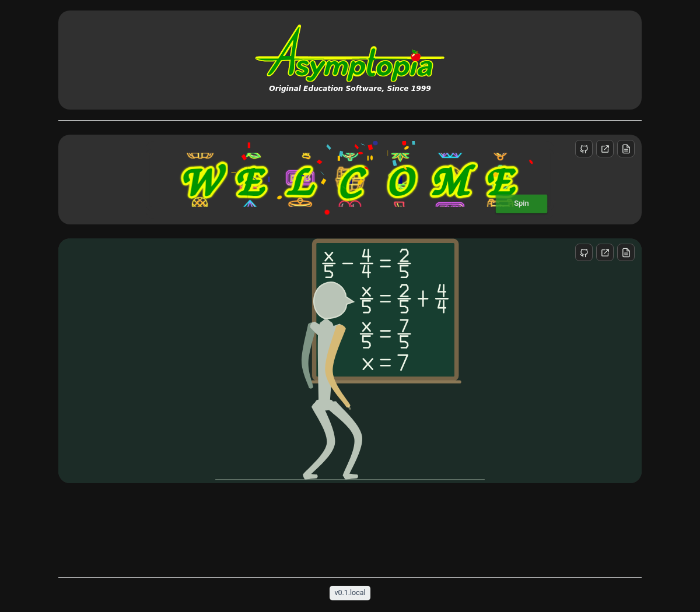
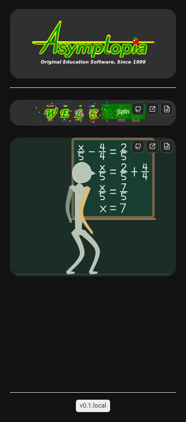
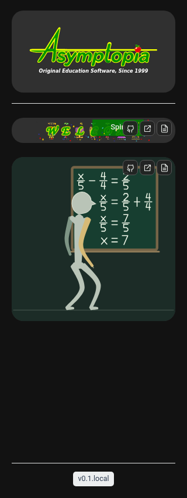

# Professor release and homepage integration (B2.1)

The authoritative source is `prototypes/professor-stick-figure/`, developed from
`milestone/professor-b1.9.3b` and `feature/professor-b2-compact-demo`. Both prior
branches and benchmark commits are preserved. No experimental Neon Tux artwork
or application is included.

The homepage custom element in `src/components/ProfessorDemo.astro` calls
`mountProfessorDemo` directly. It mounts one silent, looping compact scene and
destroys it when disconnected; it does not copy the rig or mathematical engines.
The WELCOME component, dependency pin, configuration, markup and styles remain
unchanged. The existing browser assertions now scope WELCOME icons to its panel
because the Professor has a second independent set of Source/Live/Page overlays.

- Source: https://github.com/AsymptopiaSoftware/asymptopiasoftware.github.io/tree/main/prototypes/professor-stick-figure
- Full application: `/professor/standalone.html`
- Project information: `/projects/professor/`

The Live endpoint imports the generated full standalone HTML as raw build-time
content. There is one authoritative standalone file, rather than a maintained
copy in public assets. Regenerate both previews using:

```sh
cd prototypes/professor-stick-figure
npm run build:standalone
npm test
```

The site's source, Live and Page links, problem, accessible label, project-page
copy and labels are owner-editable in `src/content/professor.json` through the
GitHub editor. The project page renders that content as static HTML. Changing
`problem` must be followed by the regression checks below to confirm reach and
framing for the new lesson.

```sh
npm ci --no-audit --no-fund
npm test
npm run build
npx playwright install chromium
node --test tests/*.browser.mjs
```

`BROWSER_PATH` can select an installed Chromium. `EVIDENCE_DIR` saves desktop and
mobile screenshots. See the prototype's `docs/compact-demo.md` for lifecycle and
engine details, and its independent browser suites for speech, teaching cadence,
walking, bounds, gestures, multi-instance rendering and cleanup coverage.

Merging into main triggers **Deploy Astro to GitHub Pages** (`deploy.yml`). It
runs both homepage browser suites before uploading and deploying the artifact.
Inspect that custom workflow's build and deploy jobs, rather than the unrelated
historical `pages build and deployment` workflow. No DNS or legacy-site hosting
configuration is changed.

## Browser evidence






