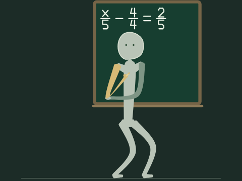
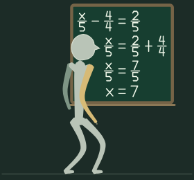
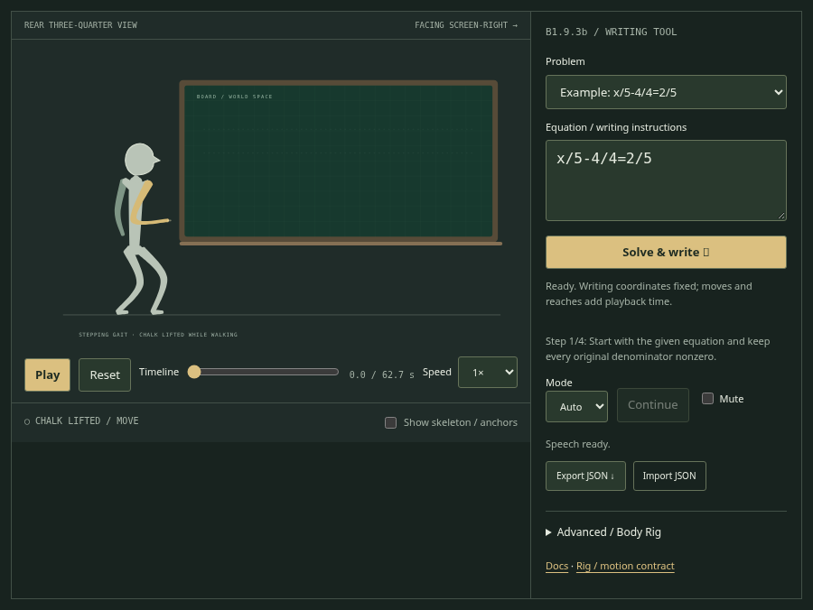

# Compact Professor embedding (B2.1)

`standalone.html` remains the full B1.9.3b application, including problem selection,
sidebar, debugging, speech, timeline and teaching controls. `demo-standalone.html`
is a second, self-contained offline HTML entry: only the board and character.
Download/open either file, or serve the modular example `examples/embedded.html`
from the prototypes directory. No framework, build step, service or API is needed
at runtime. Both standalone outputs are generated from the same engine sources.

```html
<div class="professor-tile" style="width:100%;height:360px"></div>
<script type="module">
import {mountProfessorDemo} from './prototypes/professor-stick-figure/src/compact-demo.js';
const demo = mountProfessorDemo(document.querySelector('.professor-tile'), {
  problem: 'x/5-4/4=2/5', autoplay: true, loop: true, muted: true
});
// demo.pause(); demo.play(); demo.reset();
// On unmount:
// demo.destroy();
</script>
```

Serve ES modules over HTTP with their sibling `drawing-arm`, `math-layout` and
`math-problems` directories intact. The generated compact standalone file inlines
these same modules and needs no server. Use the full tool to explore problems;
the compact component accepts uniquely solvable fraction equations supported by
the solver and throws before mounting for invalid or unreachable lessons.

## Instance contract

- Defaults are the example above. `play()` resumes; `pause()` stops the animation
  clock. `reset()` rewinds and pauses. `seek(milliseconds)` reconstructs a clamped
  timeline position, preserving transport state and cancelling current speech.
- `getState()` returns a snapshot of `time`, `duration` (milliseconds), `playing`,
  `loops`, `reducedMotion`, and `destroyed`. The duration excludes the 2-second
  completed-scene loop hold. A non-looping demo stops on the completed solution.
- Each mount owns its wrapper, SVG, rig, clock, observer and media listener. No
  IDs, global selectors, document styles or host-style mutations are used.
  Existing container children remain untouched. Call `destroy()` when removing
  an embed; it is idempotent and releases all owned resources.
- `ResizeObserver` responds to the container; window resize is the fallback.
  A width-only container derives height from the scene aspect ratio. An explicit
  width/height fits the complete scene without distortion, with letterboxing
  where necessary. No fixed minimum width is imposed.
- The camera is computed once from the verified writing bounds and sampled rig
  poses with silhouette padding. Chalk coordinates, planning and body proportions
  remain unchanged. The default character occupies about 80% of scene height.
- Reduced motion shows the completed equation sequence immediately, silently,
  with no animation frame scheduled. Play/reset/seek respect the preference.
  Preference changes are observed; returning to normal motion restarts the demo
  if playback was requested.
- Embedded mode is silent by default and never touches the browser speech queue.
  `muted:false` opts into the existing browser speech adapter, subject to browser
  voice/activation support. Only one audible compact embed owns the shared browser
  speech queue at a time; other embeds keep presenting silently until ownership is
  released by reset/seek/destroy. Do not concurrently run audible compact and full
  applications: browser speech synthesis has a document-wide cancellation queue.

## Shared architecture

`compact-demo.js` is only the component shell and transport. It calls the existing
exact solver, certified math timeline adapter, `ProfessorFigure`, and presentation
sampler. `compact-scene.js` calculates framing only. It neither changes nor copies
Drawing Arm IK, glyphs, stacked fractions, equals alignment, walking, reach
planning, teaching cadence, existing full-application thoughtful poses, or anatomical projection.
Compact lessons explicitly select `present` with `indicatingArm: "right"`: one
arm gestures gently toward the board while anatomical left remains relaxed.
The default thoughtful-explain vocabulary remains available in the full tool.
`scripts/standalone.js` bundles both entry points from one dependency list. The
full application source and controls remain unchanged.

## Validation and screenshots

```sh
npm test
npm run build:standalone
# Install/provide Playwright separately for browser checks:
node tests/browser-compact.mjs
STANDALONE_HTTP=1 node tests/browser.mjs
```

Browser tests cover both entry points, desktop/mobile tiles, visible SVG bounds
through the complete animation, independent mounts, deterministic seeking,
autoplay/loop/reset/cleanup, width-only resizing, reduced motion and full-tool
coexistence. `PLAYWRIGHT_MODULE` and `CHROMIUM_PATH` can select installed browser
tooling. Screenshots are under `docs/compact-*.svg` (embedded PNG browser captures).
No production page imports this component.






